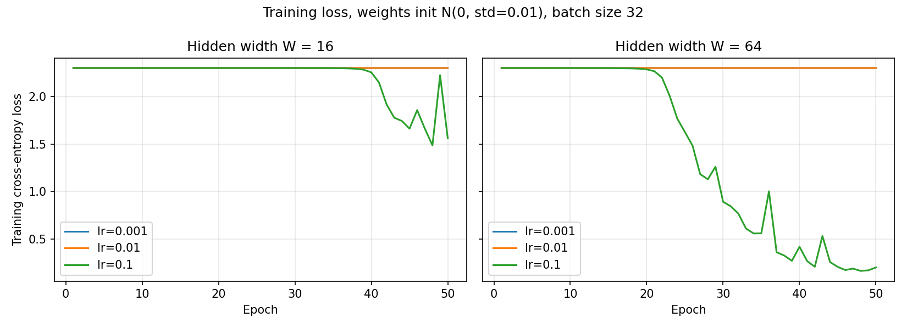
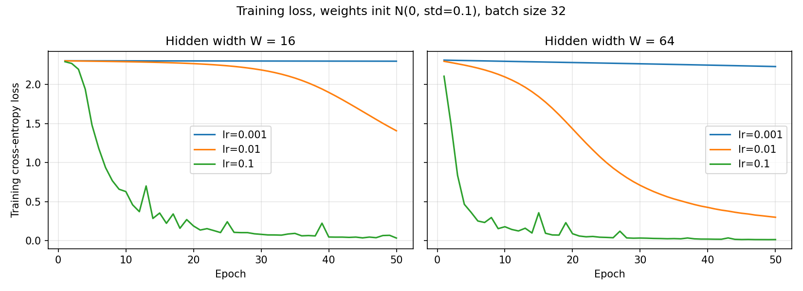

# Lab 2: A neural network from scratch

## 1. Goal
The goal of this lab is to build a two-hidden-layer neural network using only NumPy: forward pass, cross-entropy loss, and backpropagation derived by hand. I validate the gradients with numerical gradient checking, train the network on the `load_digits` dataset with different learning rates and hidden widths, and measure how much time the forward and backward passes take.

## 2. Method
- Data: `load_digits` (1797 samples, 64 features, 10 classes). Inputs divided by 16, labels one-hot encoded, 70/30 stratified split with `random_state=42` (1257 train, 540 test).
- Network: 64 → W → ReLU → W → ReLU → 10 → softmax, with W = 16 and W = 64.
- Loss: mean cross-entropy over the batch.
- Training: mini-batch SGD, batch size 32, 50 epochs, reshuffled every epoch, learning rates [0.001, 0.01, 0.1], widths [16, 64].
- Gradient check: 10 random weights (from W1, W2, W3, skipping duplicates and weights with exactly zero gradient), central difference with step ±1e-5, on a fixed batch of 64 training samples.
- Timing: median of 100 runs after 10 warm-up runs, BLAS limited to 1 thread (OPENBLAS_NUM_THREADS=1), batch sizes 32 and 1257
- Code: `src/nn.py`, `src/run_checks.py`, `src/train.py`, `src/timing.py`

### Network design (on paper)

| Parameter | Shape | Count (W=16) | Count (W=64) |
|---|---|---|---|
| W1 | (64, W) | 1024 | 4096 |
| b1 | (W,) | 16 | 64 |
| W2 | (W, W) | 256 | 4096 |
| b2 | (W,) | 16 | 64 |
| W3 | (W, 10) | 160 | 640 |
| b3 | (10,) | 10 | 10 |
| **Total** | | **1482** | **8970** |

Forward pass for a batch X of shape (N, 64):

```
z1 = X  W1 + b1      (N, W)
a1 = ReLU(z1)        (N, W)
z2 = a1 W2 + b2      (N, W)
a2 = ReLU(z2)        (N, W)
z3 = a2 W3 + b3      (N, 10)
p  = softmax(z3)     (N, 10)
L  = -(1/N) * sum_n sum_k Y_nk * log(p_nk)
```

### Gradients (derived with the chain rule)
For one sample, softmax followed by cross-entropy gives a simple result: dL/dz3 = p − Y. With the mean over the batch, this becomes (p − Y) / N. For a linear layer z = aW + b, the chain rule gives dW = aᵀ·dz, db = the sum of dz over the batch rows, and da = dz·Wᵀ. ReLU passes the gradient only where its input was positive: dz = da ⊙ (z > 0).

```
dz3 = (p - Y) / N
dW3 = a2ᵀ dz3        db3 = sum_rows(dz3)        da2 = dz3 W3ᵀ
dz2 = da2 ⊙ (z2 > 0)
dW2 = a1ᵀ dz2        db2 = sum_rows(dz2)        da1 = dz2 W2ᵀ
dz1 = da1 ⊙ (z1 > 0)
dW1 = Xᵀ dz1         db1 = sum_rows(dz1)
```

Note on the initialisation: the manual says `N(0, 0.01)`. This can mean standard deviation 0.01 or variance 0.01 (standard deviation 0.1). I ran both and report both. Biases start at zero.

## 3. Results

### Forward pass and loss checks
Taken from `results/checks.txt`.

| Check | W = 16 | W = 64 |
|---|---|---|
| Output shape for a batch of 32 | (32, 10) | (32, 10) |
| Max abs(row sum − 1) | 3.33e-16 | 3.33e-16 |
| Untrained loss (ln 10 = 2.3026) | 2.3026 | 2.3026 |

### Gradient check
Taken from `results/checks.txt` and `results/gradient_check.csv`. A weight passes if its relative error |analytic − numeric| / (|analytic| + |numeric|) is below 1e-6.

| Initialisation | W = 16 | W = 64 |
|---|---|---|
| N(0, std=0.01) | 7/10 pass (max rel. error 7.8e-06) | 7/10 pass (max rel. error 1.6e-06) |
| N(0, std=0.1) | 10/10 pass (max rel. error 1.8e-08) | 10/10 pass (max rel. error 7.2e-08) |

- With std 0.01 the gradients are very small (around 1e-5 to 1e-6), so the float64 round-off in the numerical slope is already close to 1e-6 relative error. The weights that fail there miss the threshold by a small factor (the worst relative error is 7.8e-06), not by orders of magnitude, so the check is precision-limited and does not point to a bug in the backward pass.
- With std 0.1 the gradients are larger, the numerical slope is accurate, and all 10 weights pass in both networks, with relative errors between 4e-11 and 7e-08. This is the passing gradient check for this lab. It shows that the analytic gradients of all three weight matrices match the numerical ones.
- Weights whose gradient is exactly zero (for example pixels that are always 0, or dead ReLU units) were skipped, because 0 vs 0 proves nothing.

### Training
Taken from `results/final_accuracy.csv`. Loss curves: `results/loss_curves.png` (std 0.01) and `results/loss_curves_std0.1.png` (std 0.1).





Final test accuracy after 50 epochs:

| Init std | Width | lr = 0.001 | lr = 0.01 | lr = 0.1 |
|---|---|---|---|---|
| 0.01 | 16 | 0.1019 | 0.1019 | 0.5037 |
| 0.01 | 64 | 0.1019 | 0.1019 | 0.9056 |
| 0.1 | 16 | 0.1833 | 0.6315 | 0.9556 |
| 0.1 | 64 | 0.3593 | 0.9204 | 0.9667 |

Notes:
- With std 0.01 the loss stays at about 2.30 (= ln 10) and the test accuracy stays at 0.1019 (chance level, the network always predicts one class) for lr = 0.001 and lr = 0.01, in both widths. The weights are so small that every layer shrinks the signal: the logits are close to 0 and the gradients that reach the early layers are tiny, so the network sits on a plateau. Only lr = 0.1 escapes it within 50 epochs: W = 64 leaves the plateau around epoch 20 and reaches 0.9056, while W = 16 leaves it only around epoch 40 and ends at 0.5037, still falling and noisy. (In `loss_curves.png` the lr = 0.001 and lr = 0.01 lines lie on top of each other.)
- With std 0.1 (the "variance 0.01" reading) training works much better. The larger the learning rate, the faster the loss falls, and the wider network is better than W = 16 at every learning rate. The best result is W = 64 with lr = 0.1: final test accuracy 0.9667 and training loss 0.0145. W = 16 with lr = 0.1 reaches 0.9556.
- lr = 0.001 is too small for 50 epochs in every setting (best accuracy 0.3593). lr = 0.1 is the best of the three here, and no run diverged. The training loss of the best runs is much lower than the test loss (0.0145 vs 0.1145 for W = 64), so there is some overfitting, which is normal for this small dataset.

### Timing
Taken from `results/timing.csv` (median of 100 runs). Machine: Windows 10, 11th Gen Intel Core i5-1135G7 @ 2.40 GHz, 8 GB RAM.

| Width | Batch | Forward (ms) | Backward (ms) | Backward / forward | Matmul FLOP ratio (bwd / fwd) |
|---|---|---|---|---|---|
| 16 | 32 | 0.0230 | 0.0252 | 1.10 | 1.29 |
| 64 | 32 | 0.0339 | 0.0440 | 1.30 | 1.54 |
| 16 | 1257 | 0.2997 | 0.2687 | 0.90 | 1.29 |
| 64 | 1257 | 1.6214 | 1.9629 | 1.21 | 1.54 |

- The forward pass has 3 matrix multiplications (X·W1, a1·W2, a2·W3). The backward pass has 5 (dW3, da2, dW2, da1, dW1), so it does about 1.3× (W = 16) to 1.5× (W = 64) more multiply-add work than the forward pass. Almost all of the work in both passes is matrix multiplication: the other operations (adding the bias, ReLU, softmax, the elementwise ReLU mask) cost only O(N·W) each, while a matrix multiplication costs O(N·W²). So the backward pass should be slower than the forward pass by about the FLOP ratio.
- The measurements were taken with BLAS limited to one thread, because with several threads the small-matrix timings were noisy. In three of the four settings the backward pass is slower than the forward pass, with a ratio of 1.10 (W = 16, batch 32), 1.30 (W = 64, batch 32) and 1.21 (W = 64, batch 1257), below the FLOP ratios of 1.29 and 1.54. The ratio is below the FLOP ratio because the forward pass also contains work that is not a matrix multiplication (bias addition, ReLU, and the exponentials in the softmax), and because for small matrices the fixed per-call overhead of Python and NumPy takes a large share of the time. For W = 16 with the full training set the backward pass is even slightly faster (ratio 0.90): the matrix multiplications are small there, so the elementwise work in the forward pass, probably mostly the softmax, is a large part of its time. I did not profile this, so it is an explanation, not a measurement. For W = 64 the matrix multiplications are larger and the ratio is closest to the FLOP ratio.

## 4. Conclusions
1. The analytic gradients are correct: with std 0.1, all 10 checked weights pass (relative error below 1e-6) in both networks. With the literal std 0.01 only 7/10 pass, but the errors are only a few times 1e-6, because the gradients are so small that float64 round-off limits the numerical check.
2. The initialisation scale matters a lot for this 3-layer ReLU network. With std 0.01 the network stays on a loss plateau (accuracy 0.1019) unless the learning rate is 0.1, and then only W = 64 learns well (0.9056). With std 0.1 the best setting is W = 64 with lr = 0.1 (test accuracy 0.9667). Wider is better, and lr = 0.001 is too slow for 50 epochs.
3. The backward pass needs 5 matrix multiplications instead of 3, and it was slower than the forward pass in three of the four settings (ratio 1.10-1.30), roughly following the extra matrix-multiplication FLOPs. Matrix multiplication dominates more as the matrices grow (W = 64), while for tiny matrices the non-matmul work and call overhead matter more.
